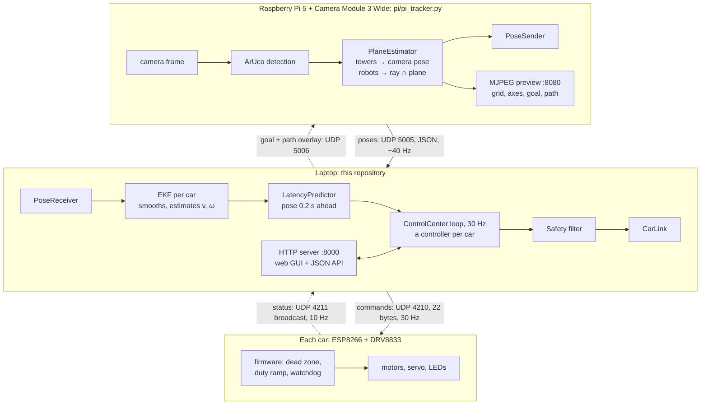
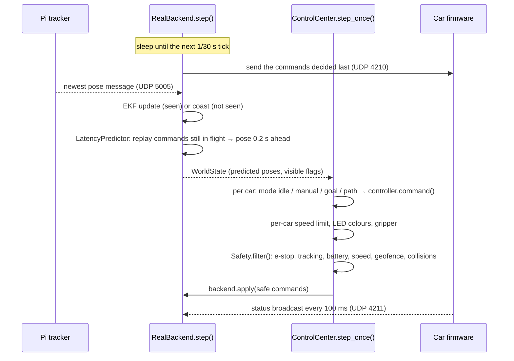

# Architecture: how the software fits together

RoboField splits a robot into two halves. The **car** is deliberately dumb: it has no sensors and
no decision-making, only motors, a gripper and lights. The **environment** is smart: an overhead
camera sees every car, and a laptop decides what each one should do. This page walks through every
piece of software involved, where it runs, and how one decision travels from a camera frame to a
spinning wheel.

## 1. Three machines



| Machine | Runs | Why there |
|---|---|---|
| Raspberry Pi 5 | `pi/pi_tracker.py` only | The Pi camera needs a Pi. Detecting on the Pi sends a few hundred bytes of poses instead of a video stream, which would add 50–150 ms of encoding delay |
| Laptop | everything in `robofield/` and `tools/` | Plenty of CPU, a screen, and Python packages (MuJoCo, PyTorch) that do not fit on a microcontroller |
| Car | `firmware/car_esp8266/` | Only what has to be on the car: driving the motors, and stopping on its own if the laptop goes silent |

### Network ports

| Port | Protocol | From → to | What |
|---|---|---|---|
| 5005 | UDP, JSON | Pi → laptop (broadcast by default) | Every marker's field pose, about 30–50 times a second |
| 5006 | UDP, JSON | laptop → Pi | Goal and path to draw on the camera preview |
| 8080 | HTTP (MJPEG) | Pi → browser | Live camera view with the tracking overlay |
| 4210 | UDP, binary | laptop → car | 22-byte command packet, 30 times a second ([protocol](protocol.md)) |
| 4211 | UDP, binary | car → everyone (broadcast) | 12-byte status packet, 10 times a second |
| 3232 | ArduinoOTA | laptop → car | Firmware updates over WiFi |
| 8000 | HTTP | laptop → browser | Control Center web page and JSON API |

## 2. Repository map

```
robofield/                 the Python package (installed with pip install -e .)
  core/                    shared types: Pose, RobotState, WorldState, RobotCommand, Backend, config loader
  control/                 kinematics + motor model, EKF, delay predictor, controllers, path helpers
  app/                     Control Center: the 30 Hz loop, safety layer, HTTP server, web pages
  real/                    RealBackend: the real field behind the Backend interface
  sim/                     SimBackend: a MuJoCo model of the same field behind the same interface
  comm/                    UDP links: laptop <-> cars, Pi <-> laptop; packet encoding
  vision/                  ArUco detection and the three pose estimators (used by the Pi)
  games/                   game plugins (goto, sumo, race): observation, reward, done
  envs/                    Gymnasium (one agent) and PettingZoo (many agents) wrappers around a game
pi/                        what runs on the Raspberry Pi: tracker, lens calibration, camera sources
firmware/car_esp8266/      the firmware the cars run (Arduino IDE)
firmware/car/, gateway/    the original ESP32-C3 / PlatformIO firmware (legacy, same protocol)
tools/                     command-line programs: Control Center, calibration, measurement, demos, training
config/                    field.yaml (every measurement), tuning.yaml, cars.json, moves/
tests/                     pytest suite, runs without hardware
docs/                      this documentation
hardware/                  CAD assemblies of the car and the field
```

## 3. Package by package

### `robofield/core` — the shared vocabulary

Everything else imports from here, so every module speaks the same units (mm, rad, s) and the same
frame ([coordinates](coordinates.md)).

| Name | File | What it is |
|---|---|---|
| `Pose` | `types.py` | One detected marker: id, x, y, theta, capture time, quality 0–1 |
| `wrap_angle(a)` | `types.py` | Wraps an angle into (−π, π]; used everywhere a heading difference is taken |
| `RobotState` | `state.py` | One car: x, y, theta, forward speed v, turn rate ω, visible, battery |
| `WorldState` | `state.py` | Time plus a dict of `RobotState` and `ObjectState`; what every backend returns |
| `RobotCommand` | `state.py` | What a car should do: left and right wheel command (−1..1), gripper (0..1), 3 LED colours |
| `Backend` | `backend.py` | The abstract interface: `reset()`, `apply(commands)`, `step()`, `state()` |
| `load_config()` | `config.py` | Reads `config/field.yaml`, normalises tower coordinates, remembers the file path |

### `robofield/control` — turning poses into wheel commands

| Module | Key names | Job |
|---|---|---|
| `kinematics.py` | `DiffDrive`, `integrate`, `safety_margin_mm` | The car's geometry and measured motor curve; converts body motion (v, ω) to wheel commands and back. See [kinematics](kinematics.md) |
| `estimator.py` | `RobotEKF` | Extended Kalman filter per car: smooths camera noise, estimates v and ω, bridges missed frames |
| `predictor.py` | `LatencyPredictor` | Smith predictor: replays the commands already sent through the motor model to report where the car *will be* 0.2 s from now |
| `pose_controller.py` | `PoseController` | The main controller: turn to face the path, follow it with pure pursuit, turn to the final heading |
| `goto.py` | `TurnTo`, `GoToPoint`, `compensate_deadzone` | `TurnTo` is the pulse-and-wait heading controller used by `PoseController`. `GoToPoint` is a simpler point controller used by a few tools |
| `path.py` | `straight_path`, `clamp_to_field`, `path_length` | Straight-line paths kept inside the safe area |
| `pid.py` | `PID` | Generic PID with derivative on the measured rate; used by `GoToPoint` |

How these fit together is in [motion control](control.md).

### `robofield/app` — the Control Center

| Module | Key names | Job |
|---|---|---|
| `control_center.py` | `ControlCenter`, `CarProfile`, `TUNING_SCHEMA` | The hub. Owns one controller per car, runs the 30 Hz loop, keeps car profiles, live tuning, saved moves |
| `safety.py` | `Safety`, `SafetySettings` | Filters every command, every step: e-stop, lost tracking, geofence, collisions, speed limit, battery |
| `server.py` | `serve()`, `make_handler()` | A small threaded HTTP server: the two web pages plus a JSON API that calls `ControlCenter` methods |
| `static/index.html` | | The main page: car list, live map, go-to-pose, path drawing, camera, moves, safety, log |
| `static/tuning.html` | | The tuning page: every parameter as a slider, a test map, live telemetry |
| `policy.py` | `PolicyDriver` | A trained RL policy driving one car, inside the Control Center (so through safety). Mode `policy` |
| `runtime.py` | `AppRuntime`, `TOOLS` | The app: one Control Center switchable between simulator and real field, the trained policies, starting jobs |
| `jobs.py` | `JobManager` | Training, evaluation, auto-tuning and tools as background processes, their output and curves |
| `camera.py` | `CameraHub` | The Camera tab's feed: the Pi's stream relayed, or the simulator's overhead camera rendered; snapshots, recording |
| `static/app.html`, `view3d.html`, `camera.html`, `training.html`, `lab.html`, `tools.html` | | The app's shell with its tabs, and one page per tab |

Everything that wants to move a car (the web page, `tools/demo.py`, `tools/film_move.py`,
`tools/eval_motion.py`, a future game or RL policy) goes through `ControlCenter`, so it all gets the
safety layer and the GUI for free. Page by page: [Control Center](control_center.md).

### `robofield/real` and `robofield/sim` — two backends, one interface

`RealBackend` and `SimBackend` both implement `Backend`, so the Control Center, the controllers and
the RL environments do not know which one they are talking to.

| | `RealBackend` (`real/backend.py`) | `SimBackend` (`sim/backend.py` + `sim/scene.py`) |
|---|---|---|
| Where poses come from | `PoseReceiver` (UDP from the Pi), then an EKF per car | MuJoCo physics, plus Gaussian noise (0.8 mm, 0.01 rad) |
| Where commands go | `CarLink` (UDP to each car) | MuJoCo motor actuators |
| Loop delay | real: ~0.2 s | a delay line of `latency_s × rate_hz` steps (6 steps at 0.2 s and 30 Hz) |
| Motor behaviour | real | the measured speed curve, the firmware duty ramp, optional per-wheel gain mismatch |
| `reset(layout)` | cannot teleport cars: stops them and returns the current state | places the cars exactly; with `randomize`, re-draws friction, mass, latency, motor gains and noise |
| Delay prediction | on (`predict = True`) | off by default (raw observations for RL), switched on by the Control Center |
| Per-car quirks | `wheels_swapped` swaps the two wheel fields at the radio, for a car wired the other way round | |

The simulated field is generated from `config/field.yaml` (`sim/scene.py`), not imported from CAD:
change a measurement in the config and the simulator changes with it.

### `robofield/comm` — the wires that are not wires

| Module | Key names | Job |
|---|---|---|
| `protocol.py` | `Command`, `Status`, `crc8`, `config_packet` | Encodes and decodes the binary car packets ([protocol](protocol.md)) |
| `udp_link.py` | `CarLink` | Listens for car status broadcasts, learns each car's IP, sends commands to it |
| `pose_link.py` | `PoseSender`, `PoseReceiver`, `OverlaySender`, `OverlayReceiver` | The JSON pose stream Pi → laptop, and the overlay stream laptop → Pi |
| `gateway.py` | | USB-serial link to an ESP-NOW gateway (an alternative to WiFi, from the ESP32 days) |

`PoseReceiver.poll()` always returns the newest message and drops older ones still in the buffer,
so the laptop never works through a backlog of stale frames.

### `robofield/vision` and `pi/` — seeing the field

| File | Job |
|---|---|
| `vision/base.py` | `make_detector()` (ArUco, `DICT_4X4_50`, sub-pixel corners) and the `PoseEstimator` interface |
| `vision/plane.py` | **The estimator in use.** Solves the camera pose from the four towers' marker corners, then intersects each robot marker's corner rays with the plane at the car's marker height |
| `vision/homography.py`, `vision/pnp.py` | Two alternative estimators, kept for comparison |
| `pi/pi_tracker.py` | The tracker program: capture → detect → estimate → send, plus the MJPEG preview with the field grid, axes, heading arrows, goal and path drawn on the real image |
| `pi/frame_source.py` | Camera sources: the Pi camera (focus, exposure and gain locked), any OpenCV camera, or image files |
| `pi/pi_calibrate.py` | Lens calibration with a printed chessboard, saved to `pi/camera.npz` |

Details and the reasoning behind the plane estimator: [vision](vision.md).

### `robofield/games` and `robofield/envs` — games and reinforcement learning

A game is a plugin that only reads `WorldState` and returns observations, rewards and a done flag,
so the same game runs in the simulator and on the real field.

| File | Job |
|---|---|
| `games/base.py` | `Game` base class, `@register("name")`, `make_game()` |
| `games/goto.py` | Reach a random point as fast as possible (the first RL task) |
| `games/sumo.py` | Two cars, push the other out of the ring |
| `games/race.py` | Three laps around the outer ring of tiles without leaving it |
| `envs/gym_env.py` | `RoboFieldEnv`: a Gymnasium environment for one car; action = (left, right) |
| `envs/pz_env.py` | A PettingZoo parallel environment for several cars |

`tools/train_race.py` trains a PPO policy (Stable-Baselines3) on the race in the simulator, with
domain randomization so it transfers to the real car.

### `firmware/car_esp8266` — the car

One Arduino sketch. Each loop it reads command packets, applies them, and broadcasts its status
every 100 ms. On its own it:

- lifts every non-zero wheel command above that wheel's dead zone (`LEFT_DEADZONE 0.26`,
  `RIGHT_DEADZONE 0.20`), so a small command still moves the wheel;
- ramps the motor duty at most 6.0 per second (full power in ~0.17 s), so it does not pop a wheelie;
- turns the motors off if no valid command arrives for 200 ms (the watchdog), so a crashed laptop
  or lost WiFi never leaves a car driving;
- stores its robot id in EEPROM (set over serial with `id 0`, or over WiFi with `tools/cars.py set-id`);
- accepts firmware updates over WiFi (ArduinoOTA).

Wiring, flashing and the known trade-offs: [`firmware/car_esp8266/README.md`](../firmware/car_esp8266/README.md).

### `tools/` — the programs you run

| Tool | Use it to |
|---|---|
| `robofield_app.py` | **The RoboField app** ([app](app.md)): every page below in one window, simulator or real field |
| `control_center.py` | Just the Control Center (simulator by default, `--real --pi <ip>` for the field) |
| `train.py` | Train or evaluate a PPO policy for any one-car game; the app's Training tab runs it |
| `autotune.py` | Search for good controller settings on a test course, in simulators or on the car |
| `cars.py` | List cars on the network, set a car's id, run a self-test, drive with the keyboard |
| `measure_latency.py` | Measure the command-to-camera delay of your setup |
| `calibrate_motors.py` | Measure the top wheel speed and the left/right trim, optionally write them to the config |
| `eval_motion.py` | Score straight lines, turns and curves with numbers |
| `demo.py`, `film_move.py`, `record_camera.py`, `record_screen.py` | Demo drives and filming |
| `real_goto.py`, `goal_gui.py`, `drive.py`, `track_demo.py` | Small standalone tests, older than the Control Center |
| `calibrate_camera.py`, `generate_markers.py` | Lens calibration with a USB camera, printable markers |
| `train_race.py` | Train or watch the race policy |

## 4. One control cycle, step by step

The loop runs 30 times a second in `ControlCenter._loop()`. In real mode the pacing comes from
`RealBackend.step()`, which sleeps until the next 1/30 s tick.



In detail, one cycle does this:

1. **Send and read.** `RealBackend.step()` waits for the next tick, reads every car status that
   arrived (so it knows each car's IP and battery), sends the commands decided last, and takes the
   newest pose message from the Pi. A message is only used if it is under 0.5 s old and is a new frame (its sequence
   number changed).
2. **Filter.** Each robot marker (id 10 + robot number) updates that car's EKF. A car without a
   detection this frame is coasted forward on its motion model. A detection more than 80 mm from
   the filter's estimate is treated as a re-lock rather than averaged in.
3. **Predict.** The filtered pose is pushed 0.2 s into the future by replaying the commands sent
   during the last 0.2 s through the motor model. This is the pose the controllers see.
4. **Decide.** For each car, `step_once()` looks at its mode:
   - `idle`: zero command;
   - `manual`: the last keyboard command, if it is under 0.3 s old (a dead-man switch);
   - `goal` or `path`: `PoseController.command(x, y, theta, omega, dt)`; when the controller
     reports `done`, the car goes back to `idle`.
5. **Limit.** A car's own `max_speed` scales its body motion (v and ω together, so its path
   keeps its shape). LEDs, the identify blink and the e-stop red are added.
6. **Make it safe.** `Safety.filter()` checks every command against every rule
   (see [Control Center](control_center.md#safety)). A command it does not change is passed through
   untouched.
7. **Send.** `backend.apply()` stores the commands; the next `step()` sends them.

### Where the 0.2 s goes

Measured with `tools/measure_latency.py` (median 234 ms including the motors spinning up):

```
command leaves the laptop → WiFi → firmware duty ramp → motors spin up → the car moves
→ next camera exposure → ArUco + pose on the Pi (~23 ms) → UDP to the laptop → next loop tick
```

The loop cannot make this shorter, so it predicts across it instead ([motion control](control.md#2-predict-dont-react--robofieldcontrolpredictorpy)).

## 5. Threads and shared state

| Thread | Started by | Does |
|---|---|---|
| Control loop | `ControlCenter.start()` | `step_once()` then `backend.step()`, forever. An exception is logged and the loop continues |
| HTTP server threads | `serve()` (`ThreadingHTTPServer`) | One per request; each calls a `ControlCenter` method |
| Move threads | `move_to_start()`, `play_move()` | Park the car at a move's start (two legs), then start the path |
| Job readers | `JobManager.start()` (the app) | One per background process: collect its output, learning curve and result |
| Pi preview | `pi_tracker.py` | Serves MJPEG frames while the main thread tracks |

`ControlCenter.lock` (a re-entrant lock) guards the shared state: modes, controllers, profiles,
tuning. The loop holds it while deciding and releases it during `backend.step()`, so the web page
never waits on the camera. Every new order (go, path, drive, stop, e-stop) bumps a generation
counter, `_gen`, so a move that is still parking notices it was cancelled and gives up.

## 6. Files the software reads and writes

| File | Written by | Holds |
|---|---|---|
| `config/field.yaml` | you (and `calibrate_motors.py --write`) | Every measurement: field, towers, camera, robot model, motor curve, trim, delay |
| `config/tuning.yaml` | the tuning page's **Save to config** | Controller parameters; overrides the defaults at startup. Delete it to go back |
| `config/cars.json` | the Control Center | Each car's name, map colour, LED colours, max speed, enabled flag |
| `config/moves/<name>.json` | **Save last path** in the Moves panel | A drawn path and its final heading, to replay |
| `pi/camera.npz` | `pi/pi_calibrate.py` | The lens calibration (camera matrix K, distortion D) |
| `recordings/` | the filming tools | Videos and their score files (git-ignored) |
| `logs/` | firmware flashing | Upload logs (git-ignored) |

## 7. Extending it

**Drive cars from your own script** through the running Control Center's HTTP API:

```python
import json, urllib.request

def api(path, body=None):
    req = urllib.request.Request("http://127.0.0.1:8000" + path,
                                 data=None if body is None else json.dumps(body).encode(),
                                 headers={"Content-Type": "application/json"})
    return json.loads(urllib.request.urlopen(req, timeout=3).read())

api("/api/goal", {"id": 0, "x": 700, "y": 300, "theta": 1.57})           # go to a pose
api("/api/path", {"id": 0, "points": [[200, 200], [500, 800]], "theta": None})
print(api("/api/state")["robots"][0]["phase"])                             # TURN / FOLLOW / ALIGN / DONE
```

**Or in-process**, with the same object the web page uses:

```python
from robofield.app import ControlCenter
from robofield.core import load_config
from robofield.sim.backend import SimBackend

cfg = load_config("config/field.yaml")
cc = ControlCenter(cfg, SimBackend(cfg, n_robots=2), "sim").start()
cc.set_goal(0, 700, 300, 0.0)
cc.update_car(1, leds=[[255, 0, 0]] * 3)
```

**Write a task, a policy or a system without touching the code:** the app's Lab tab and `robofield/lab.py`
load them from `custom/` ([Lab](lab.md)). Programs run in the Control Center's `program` mode.

**Add a game:** subclass `Game` in `robofield/games/`, decorate it with `@register("mygame")`,
implement `layout`, `observe`, `reward` and `done`, and set `obs_dim`. It is then available to
`RoboFieldEnv(game="mygame")`.

**Add a controller mode:** like `policy` (an RL policy, `robofield/app/policy.py`), give `ControlCenter` a new mode name and a branch in `step_once()` that
produces a `RobotCommand`. Everything after that point (speed limits, safety, LEDs, sending) is
shared.

**Add a pose estimator:** subclass `PoseEstimator`, implement `estimate_from_detections`, and add
it to `build_estimator()` in `robofield/vision/__init__.py`.
