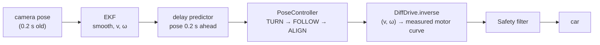
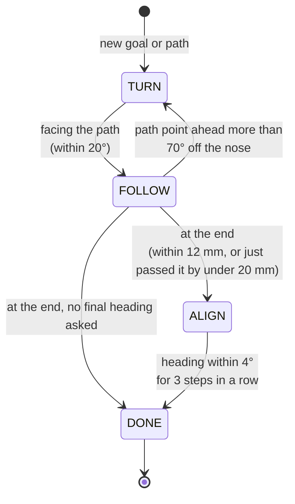
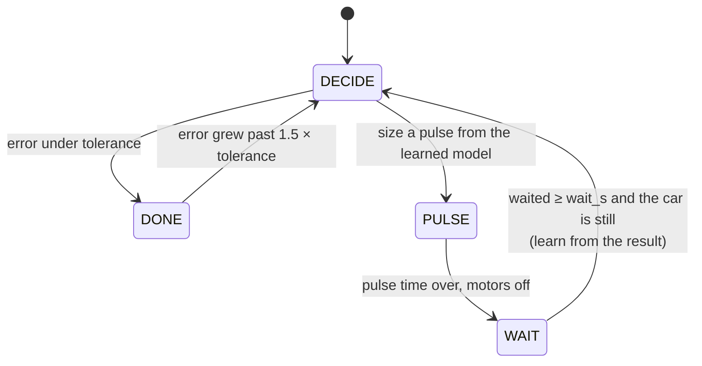

# Motion control on the real car

How RoboField drives a car that has no sensors of its own, using only an overhead camera that is
always a little behind. Every number here was measured on the real field on 2026-11-06. The tools
that measured them are in `tools/`, so they can be measured again for any new car. The equations
behind the motor model are in [kinematics](kinematics.md); the parameters you can change are in
the [tuning guide](tuning.md).

The whole chain, for one car, every 1/30 s:



## 1. Measure the car

### The loop delay — `tools/measure_latency.py`

From standstill the car is sent a short in-place turn, and the time until the camera sees its
heading change is recorded (6 trials, alternating direction).

| | median | range |
|---|---|---|
| command sent → motion seen by the laptop | **234 ms** | 157–422 ms |

This covers WiFi to the car, the firmware's duty ramp, the motors spinning up, camera exposure,
ArUco detection on the Pi (~23 ms) and the UDP hop back. The system had assumed 70 ms.
`control.latency_s` is 0.20 (the part of it that is pure delay rather than spin-up).

What a 0.2 s delay does: at the car's turning speed (3–5 rad/s), the heading the controller sees is
40–60° behind the real one. A controller correcting that stale heading keeps turning after the
robot has already arrived, overshoots, then corrects back: **the left-right oscillation at the
end of every move.**

### The motors — `tools/calibrate_motors.py`

Straight-line speed per command (`robot_model.speed_curve`):

| command | 0.03 | 0.08 | 0.15 | 0.25 | 0.50 |
|---|---|---|---|---|---|
| speed, mm/s | 116 | 152 | 185 | 200 | 282 |

- **There is no slow.** The firmware lifts every non-zero command over each wheel's dead zone, and
  those floors sit above where these motors actually start, so the smallest command already drives
  ~100 mm/s. The laptop was additionally compensating the dead zone itself, on top of the firmware,
  which made the smallest correction ~30% power; that double compensation is removed
  (`robot_model.deadzone_* = 0`).
- **Unequal motors.** With equal commands the left wheel ran 259 mm/s against the right's 239 mm/s,
  curving with a 0.6–0.9 m radius. `trim_left = 0.923` equalises them.
- **Turning in place is hard.** Spinning both wheels in opposite directions scrubs them sideways:
  it needs a big command to break free at all, then turns at 3–6 rad/s regardless of the command,
  and coasts for up to ~0.9 s after the motors stop.

Every controller maps the speed it wants through the measured curve (`DiffDrive.inverse`), so
asking for 150 mm/s gives 150 mm/s; speeds below the minimum are scaled up together so the turn
ratio, and therefore the path's curvature, is kept. Worked examples: [kinematics](kinematics.md#3-the-motor-model-what-a-command-really-does).

## 2. Predict, don't react

The code: `robofield/control/predictor.py` and `robofield/control/estimator.py`.

### First, filter: the EKF (`robofield/control/estimator.py`)

Each car has an extended Kalman filter with the state `[x, y, θ, v, ω]`. Every camera frame
corrects the position and heading; between frames, or when the car is not detected, it moves the
state forward assuming constant speed and turn rate. It gives the controllers two things the camera
does not: a smooth pose without pixel noise, and the car's measured speed and turn rate. A
detection more than 80 mm from the filter's estimate is taken as a jump (a bad detection, or the
car was picked up) and the filter re-locks onto it instead of averaging it in.

### Then, predict

Each robot's pose is reported to the controllers **0.2 s in the future**: the state the robot will
be in when the command computed now reaches it. This is a Smith predictor. It starts from the
filtered camera measurement and replays the commands that were already sent during the delay window
(on their way to the wheels, not yet visible to the camera) through the motor model, with a short
lag for the motors and the firmware ramp.

Simply extrapolating the last measured speed does not work: when the controller reverses its
steering, extrapolation keeps swinging the old way and invents an overshoot that isn't there (seen
on the real car as a predicted heading 115° away from the real one). Replaying the actual commands
knows the steering already changed.

Switch it off on the tuning page (`Prediction on (1) / off (0)`) to see the difference.

## 3. The pose controller

The code: `robofield/control/pose_controller.py`.

`PoseController` takes a car to a position **and** an orientation, along a path. Clicking a goal on
the map gives it a straight path (waypoints every 40 mm, kept 63 mm from the walls); drawing a path
gives it your points, kept inside the same margin and resampled every 20 mm. A freshly drawn path
is joined at the point nearest the car; a replayed move is followed from its first point.

It works in three phases:



| Phase | What the car does | Controller |
|---|---|---|
| **TURN** | Turns on the spot until it faces the path | `TurnTo` with a loose 20° tolerance |
| **FOLLOW** | Drives along the path | pure pursuit, section 4 |
| **ALIGN** | Turns on the spot to the requested final heading | `TurnTo` with a 4° tolerance, section 5 |
| **DONE** | Stops; the Control Center sets the car back to idle | |

Two details keep it from hunting around the goal. With a ~100 mm/s minimum speed and a 0.2 s
delay, the car cannot creep the last few millimetres, so a goal it has **just passed** by less than
20 mm counts as reached instead of being chased back and forth. And a looping path that passes its
own end point early only finishes once the car has followed it to the last waypoint.

ALIGN has a ceiling of 900 steps (30 s): a car that cannot settle (a stuck wheel, lost tracking)
stops trying.

## 4. Lines and curves — pure pursuit

The car aims at a point `lookahead` (120 mm) ahead on the path, the "carrot", and drives the
circular arc that reaches it:

```
α = angle from the car's nose to the carrot
curvature κ = 2 sin(α) / distance to the carrot
ω = v · κ
```

It is geometry, not a tuned heading loop, so straight lines do not weave and curves are followed as
curves. The speed is the smallest of three limits:

| Limit | Formula | Why |
|---|---|---|
| Cruise speed | `v_path` (200 mm/s) | The speed you want on straight parts |
| Curve speed | √(`lat_accel` / \|κ\|) | Keeps the sideways acceleration under 500 mm/s² so it does not skid or overshoot the bend |
| Braking | √(2 · `accel` · distance left) | Slows down into the goal like a real braking distance, at 400 mm/s² |

It speeds up at most `accel` per second, never drives slower than the car's minimum wheel speed,
and all of it runs on the predicted pose. If the carrot ends up more than 70° off the nose (the car
was pushed, or the path doubles back), it stops and turns to face it first.

## 5. Turning precisely — pulse, wait, measure (`TurnTo` in `robofield/control/goto.py`)

Because the car cannot turn slowly and coasts after stopping, no continuous controller can fine-tune
its heading: every correction is too big and arrives too late. So every turn is a sequence of moves:

1. **Pulse.** One wheel drives at 150 mm/s and the other stays still: a pivot about the still
   wheel. It breaks free far more gently than spinning both wheels, turns half as fast and coasts
   less. The wheel doing the work alternates between pulses, so each pivot's small sideways shift
   is undone by the next ([pivot geometry](kinematics.md#4-pivot-turns)).
2. **Wait.** At least 0.35 s, longer than the delay, and until the camera shows the car turning
   slower than 0.4 rad/s. No decision is ever made on data older than the move before it.
3. **Measure and learn.** The pulse length comes from a two-number model of this car:

   ```
   pulse length = start_s + |heading error| / turn_rate        (at most 0.35 s for the final turn)
   ```

   `start_s` is how long it takes to start turning from a standstill (starts at 0.06 s), and
   `turn_rate` how fast it then turns (starts at 2.5 rad/s). After every pulse the measured result
   updates them: if it turned less than 1°, `start_s` grows by 30 ms; otherwise `turn_rate` moves
   halfway to the rate it actually turned at. The model is kept per car for the whole session, so
   it adapts as the battery drains or the floor changes.



Result on the real car: a 120° turn takes ~4 s and ends within 2–5°. The old continuous controller
(still available, `New pulse turns (1) / old continuous (0)` on the tuning page) swung past the
target 14 times in 5 s and ended ~19° off.

`goto.py` also has `GoToPoint`, a simpler drive-to-a-point controller (speed proportional to
distance, heading through a PID damped on the measured turn rate). The Control Center does not use
it; a few standalone tools do.

## 6. Safety

Every command from every controller passes through `robofield/app/safety.py` before it is sent: the
e-stop, lost tracking, the battery, a speed limit, a geofence that removes forward speed toward a
wall, and collision avoidance between cars. The rules and their settings are listed in
[Control Center → Safety](control_center.md#safety).

## 7. Tuning it yourself

`http://localhost:8000/tuning` shows every parameter above as a live slider, a map to set test
goals and live telemetry. **Save to config** writes `config/tuning.yaml`, loaded on top of the
defaults at startup (delete it to go back). `tools/eval_motion.py` scores straight lines, turns and
curves with numbers, so a change can be judged by data rather than by eye. Which parameter to
change for which symptom: [tuning guide](tuning.md).

## Known limits and next steps

- Lowering `LEFT_DEADZONE` / `RIGHT_DEADZONE` in the car firmware would give the laptop real
  low-speed control (see `firmware/car_esp8266/README.md`); the speed curve and trim then need
  measuring again.
- The firmware's brake flag only lasts one loop iteration; a real brake would stop turns sooner.
- The tracker on the Pi and the laptop have unsynchronised clocks; synchronising them (NTP) would
  let the predictor use each frame's true capture time instead of a fixed delay.
