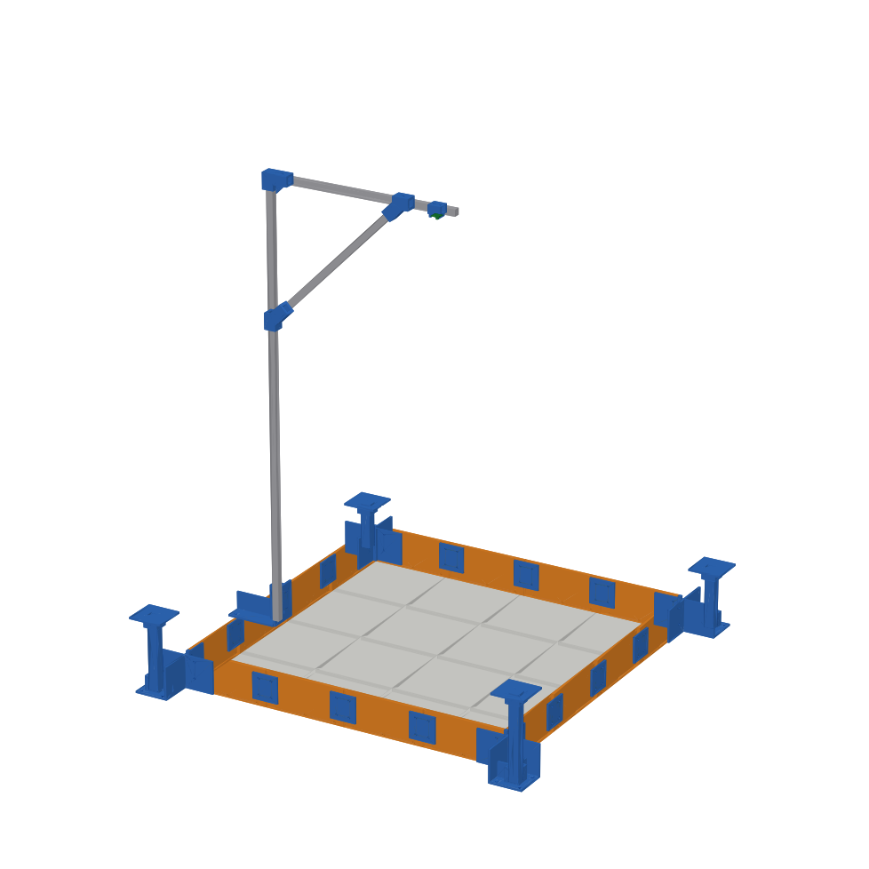
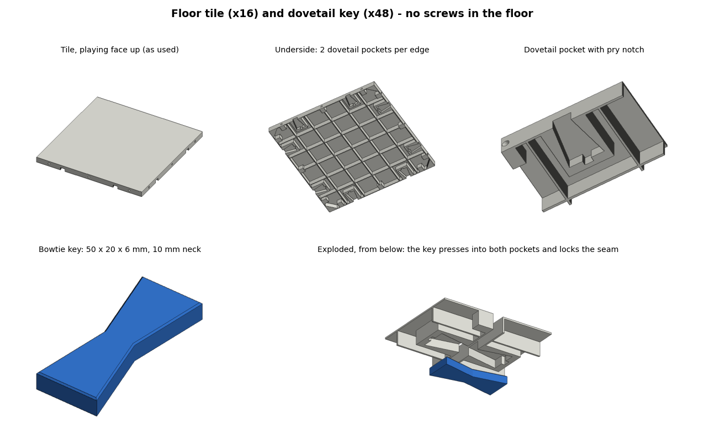

# Field (reference build v1)

Everything except the aluminium extrusions is 3D printed, and every printed part fits a
**Bambu Lab A1 (256 × 256 × 256 mm)**. The whole field uses **only M3 socket-head (cap) screws**,
and every screw goes into a **brass heat-set insert** (4 mm hole), never straight into plastic,
so it can be taken apart and rebuilt as often as you like. No M2, M4 or M5, no T-nuts.



## Playing area
- 1000 × 1000 mm, neutral multi-game mat: 100 mm grid, 4 start pads (150 mm),
  200 mm centre circle, 20 mm plain edge band. Game zones are defined in code, not printed.
- Origin (0, 0) = inner bottom-left corner of the playing area (docs/coordinates.md).

## How everything connects

| Joint | Part | Fasteners | What holds it |
|---|---|---|---|
| Tile ↔ tile | Dovetail (bowtie) key pressed into pockets under the seam, 2 per seam | **No screws** | The dovetail locks the tiles together; the pocket depth keeps them flush |
| Tile ↔ wall | Wall module stands beside the tile | 3 × M3 × 12 per module, into horizontal inserts in the tile edge | Tops line up automatically (both stand on the table) |
| Wall ↔ wall | Splice plate on the outer face | 4 × M3 × 12 into inserts (2 per module) | Closed, bolted wall ring |
| Wall corners | Tower base (with 20 × 20 corner block) | 4 × M3 × 12 into the two walls | Corner closed and squared; tower locked to the ring |
| Tower column | Printed 30 × 30 mm column, base + cap | 4 × M3 clamp screws in the base socket, 2 in the cap | Column clamped on two faces at two heights |
| Mast | Mast clamp on the left-wall joint, elbow, 2 brace clamps | 4 × M3 × 12 into the walls, M3 clamp screws | Clamp doubles as that joint's splice |
| Camera | Holder sleeve on the arm | 2 × M3 clamp screws | Slides along the arm to centre it, no T-nuts |

Result: the 16 tiles are locked into one plate by the dovetail keys, the walls form one bolted
ring, and the ring is screwed to the plate every 83 mm along the edge, so the keys cannot work
loose while the walls are on.



## Floor: 16 printed tiles (4 × 4)
- 250 × 250 × **12 mm**, ribbed (1.2 mm skin / walls / ribs), ~218 g PLA each, printed face down.
- Underside of every edge: 2 dovetail pockets (at 62.5 / 187.5 mm), 6.2 mm deep, 5.8 mm of plastic
  left under the playing face. A bowtie key (50 × 20 × 6 mm, 10 mm wide at the seam) presses into
  the pockets of two neighbouring tiles. The narrow neck locks them: they cannot pull apart or
  slide, and nothing sticks out below the tile. No screws in the floor.
- To take a seam apart, put a flat screwdriver in the pry notch at the end of the pocket and lever
  the key out.
- Every edge: 3 horizontal M3 inserts (30 / 125 / 220 mm) for the wall modules.
- Print 2 × `field_tile_edge_test_strip.stl` + 2 keys first to check the fit.

## Walls: 16 printed wall modules
250 × **10** × 112 mm (length × thickness × height from the table) = **100 mm above the field**.
One per outer tile edge, all identical. Outer face has 4 inserts (for splices, towers, mast clamp).
The 10 mm wall (was 20) and 2-wall / 10 % infill printing cut each module from ~200 g to ~95 g,
so the 16 walls take ~1.5 kg of PLA instead of ~3.2 kg. A 60 mm wall would cut that to ~0.9 kg.

## Tracking towers (outside the corners)
| Tower | Marker ID | Centre (x, y) mm | Marker height | Printed column |
|---|---|---|---|---|
| T3 | 0 | (−71, −71) | 220 mm | 220 mm |
| T4 | 1 | (1071, −71) | 260 mm | 260 mm |
| T2 | 2 | (1071, 1071) | 180 mm | 180 mm |
| T1 | 3 | (−71, 1071) | 140 mm | 140 mm |

Fully 3D printed: base + 30 × 30 mm column + cap (100 × 100 mm, 80 mm marker facing up, top edge
toward the cap's notch = +Y). Column length = marker height.

## Camera
- Raspberry Pi Camera Module 3 Wide, ~1.3 m above the playing surface, facing down.
- Mode 2304 × 1296 @ 56 fps. All four towers fit with ~80 px margin top and bottom.
- Mast: 1352 mm upright (mast clamp on the middle of the left wall), mast elbow on top,
  580 mm arm, 540 mm brace held by 2 brace clamps 424 mm from the corner.
- Camera holder: a sleeve that slides along the arm (2 × M3 clamp screws). The camera sits
  lens-down in a protective cup on 4 locating pegs; melt the peg tips with the soldering iron
  (or add a drop of hot glue) to hold it, so no M2 screws are needed.

---

# Build guide

```bash
pip install cadquery
python hardware/field/generate_field_tile.py    # tile, dovetail key, test strip
python hardware/field/generate_field_parts.py   # walls, splices, towers, mast, camera holder + assembly
python hardware/field/render_views.py           # 6-view sheets of every printed part
```

## Printed parts

| Part | File | Qty | Size (mm) | Orientation |
|---|---|---|---|---|
| Floor tile | `field_tile_250mm.stl` | 16 | 250 × 250 × 12 | Playing face down |
| Dovetail key | `field_tile_key.stl` | 48 | 50 × 20 × 6 | Flat |
| Test strip (optional) | `field_tile_edge_test_strip.stl` | 2 | 250 × 32 × 12 | Face down |
| Wall module | `wall_module.stl` | 16 | 250 × 10 × 112 | Lying on its outer face |
| Tower columns | `tower_column_T1_140mm.stl` … `T4_260mm.stl` | 1 each | 30 × 30 × 140–260 | Lying flat (260 mm diagonally) |
| Splice plate | `splice_plate.stl` | 11 | 80 × 80 × 6 | Flat |
| Tower base | `tower_base.stl` | 4 | 192 × 192 × 112 | Floor down |
| Tower cap | `tower_cap.stl` | 4 | 100 × 100 × 36 | Marker plate down |
| Mast clamp | `mast_clamp.stl` | 1 | 162 × 100 × 110 | Foot down |
| Mast elbow | `mast_elbow.stl` | 1 | 80 × 36 × 62 | On its side |
| Brace clamp | `brace_clamp.stl` | 2 | 77 × 36 × 84 | On its side |
| Camera holder | `camera_holder.stl` | 1 | 40 × 36 × 35 | Standing on a sleeve end |

Print settings (PLA, A1): tiles 0.2 mm, 3 walls, 6 bottom / 4 top, 25 % gyroid, no supports.
Keys 100 % infill. Wall modules 2 walls / 10 % gyroid. Tower parts 3 walls / 15 %.
Mast parts 4–5 walls / 30–40 %.

## Aluminium 2020 extrusion (mast only, about 2.5 m)

| Use | Length | Qty |
|---|---|---|
| Mast upright | 1352 mm | 1 |
| Mast arm | 580 mm | 1 |
| Mast brace (square-cut ends) | 540 mm | 1 |

## Hardware (M3 only)

| Item | Qty |
|---|---|
| M3 heat-set inserts for a 4 mm hole, ~4 mm long | 146 |
| &nbsp;&nbsp;– tile outer edges (16 edges × 3) | 48 |
| &nbsp;&nbsp;– wall modules, outer face (16 × 4) | 64 |
| &nbsp;&nbsp;– column / extrusion clamps (tower bases 16, caps 8, mast clamp 2, elbow 2, brace clamps 4, camera holder 2) | 34 |
| M3 × 10 socket-head screws (extrusion clamps) | 34 |
| M3 × 12 socket-head screws (splices, tower bases, mast clamp → wall modules) | 64 |
| M3 × 12 screws (wall modules → tiles; up to M3 × 16 fits) | 48 |

Wall screws into the tiles: the wall counterbores are 3.5 mm deep (enough for an M3 socket
head). Use M3 × 12; up to M3 × 16 fits thanks to the clearance hole behind every tile insert.

## Assembly

1. **Inserts:** press M3 inserts into the outer edges of the perimeter tiles, the outer faces of
   the wall modules, and every extrusion clamp hole.
2. **Floor (face down):** lay the 16 tiles **playing face down** on a clean flat table in the
   mirrored layout, edges pushed together. Press a dovetail key into every pair of pockets across
   each seam (thumb pressure or a light tap with a mallet). The keys pull the seams closed.
3. **Flip** the floor plate over (it is one rigid piece now, about 3 kg).
4. **Walls:** stand a wall module against every outer tile edge, 3 × M3 × 12 into the tile.
   Do the walls before the towers and mast clamp: those cover some of these screws.
5. **Joints:** splice plate across every wall joint (4 × M3 × 12), except the middle of the left
   wall, which gets the mast clamp.
6. **Towers:** push each printed column into its base and tighten the 4 clamp screws. Fit the
   base on its corner and screw both flanges into the walls (4 × M3 × 12). Fit the cap (notch toward +Y),
   tighten its 2 clamp screws, stick on the marker.
7. **Measure each marker's real height** above the playing surface and put it in
   `config/field.yaml`.
8. **Mast:** mast clamp onto the left-wall joint (4 × M3 × 12), upright in, brace clamps on.
   Slide the camera holder onto the arm from its free end, then push the arm into the elbow on
   top of the upright, set the brace, and tighten every M3 clamp screw. Slide the holder over the
   field centre and lock it.
9. Calibrate the camera, run `tools/track_demo.py`: all 4 towers should be detected.

## Taking it apart
Reverse order: mast → towers → splices → wall modules (all screws reachable from outside) →
flip the floor → lever the keys out with a flat screwdriver in the pry notches. For transport you can also keep the floor bolted in
four 2 × 2 quarters and only remove the keys on the two middle seams.

---

# Goalpost mast (120 cm extrusions)

Shops often only sell 2020 extrusion in 120 cm bars, so the mast can be built as a goalpost
from 3 bars, without cutting the uprights (`python hardware/field/generate_mast_goalpost.py`):

| Part | Qty | Notes |
|---|---|---|
| `mast_clamp_tall.stl` (printed, 170 × 110 × 253 mm) | 2 | Middle of the left and right walls (same part, turned). 4 × M3 into the wall inserts, cap + lip hook over the wall top. The upright stands on its floor 152 mm above the table and is gripped for 100 mm by 3 × M3 clamp screws, 7 mm off-centre so they press on the extrusion's lip, not the T-slot. Print foot-down, 5 walls, 40 % gyroid. |
| 2020 upright, 1200 mm, **uncut** | 2 | Tops at 1352 mm, as before |
| 2020 beam, 1036 mm | 1 | Cut from the third bar; ends go into the two elbows |
| `mast_elbow.stl` | 2 | Existing part, the right one turned 180° |
| `camera_holder.stl` | 1 | Existing part, slides along the beam to the centre |

Not needed with the goalpost: the old mast clamp, the 540 mm brace and the 2 brace clamps.
Supported at both ends, the beam is far stiffer than the single cantilever arm.
Hardware: 8 × M3 × 12 (clamps → walls), 6 + 4 + 2 M3 inserts and M3 × 10 clamp screws.
