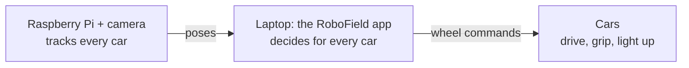

# RoboField

**Dumb robots, smart environment.** RoboField is a low-cost, open-source arena for testing robot
control and AI on real robots, not only in simulation.

A 1 × 1 m field with four marker towers is watched by one overhead camera. Each small car carries a
single ArUco marker and no sensors or computer of its own: it only drives, grips and lights up. A
laptop sees every car through the camera, decides what each one should do, and sends the commands
over WiFi. The same code drives a MuJoCo simulation of the same field, so a controller, a program or
a reinforcement-learning policy can be developed in simulation and then run on the real cars unchanged.



## What you can do with it

| | |
|---|---|
| **Drive** | click a pose or draw a path; the car follows it precisely, compensating its own delay ([motion control](control.md)) |
| **See** | a live map, a 3D view, and the camera, for the simulator and the real field alike ([the app](app.md)) |
| **Learn** | train reinforcement-learning policies with a live learning curve, then let them drive ([RL guide](reinforcement_learning.md)) |
| **Program** | write your own tasks, single-car policies and multi-car systems in Python, in the app ([Lab](lab.md)) |
| **Tune** | every controller setting live, or found automatically ([tuning guide](tuning.md)) |
| **Trust** | a safety layer under everything: geofence, keep-apart, speed limit, lost-tracking stop, e-stop |

## Start in five minutes

No hardware needed: the simulator runs the same code.

```bash
git clone https://github.com/jolianjij/robofield.git
cd robofield
```

Then run `install.bat` (Windows, double-click it) or `bash install.sh` (macOS, Linux), and open
RoboField from the Desktop icon or with `.venv/bin/python tools/robofield_app.py`. Details and
fixes: [install](install.md). What to try first: [getting started](getting_started.md).

## Measured on the real car

| Maneuver | Time | Result |
|---|---|---|
| Straight 350 mm | 2.4–3.1 s | stops 6–7 mm from the goal |
| Turn 120° in place | 3.5–4.2 s | final heading within 2–5°, no oscillation |
| Half circle, r = 170 mm | 3.3 s | stops 15 mm from the end of the drawn path |
| RL race policy, trained only in simulation | 46–49 s | 3 laps of the outer ring on the real car |

More in [testing and results](testing.md).

## Open source

MIT licensed. Code, firmware, docs and CAD: [github.com/jolianjij/robofield](https://github.com/jolianjij/robofield).
