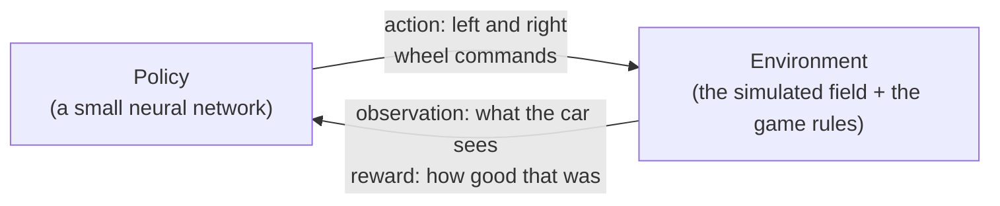

# Reinforcement learning on RoboField

A hands-on guide: what reinforcement learning (RL) is, how the race policy in this repository was
trained, how to train your own, and how to take a policy from the simulator to the real car. It
ends with the plan for two cars playing football.

## 1. The idea in one picture

In reinforcement learning nobody tells the car *how* to drive. It tries actions, gets a score
(the **reward**) after each one, and slowly learns which actions lead to high scores.



| Word | In RoboField | In the race |
|---|---|---|
| **Agent** | One car | Car 0 |
| **Environment** | The simulator (`SimBackend`) plus a game (`robofield/games/`) | The race game |
| **Observation** | A short list of numbers describing the situation, from the car's point of view | 9 numbers + the last action (below) |
| **Action** | Two numbers from −1 to 1: the left and right wheel commands | Same |
| **Reward** | A number after every step (30 per second) | Progress along the track, minus a little per second, bonuses and penalties |
| **Episode** | One attempt, from a start position until it ends | Until 3 laps, leaving the lane, or 90 s |
| **Policy** | The function from observation to action, a neural network | `models/race_random.zip` |

Training is millions of episodes in the simulator, far more than you could ever drive on the real
field. The simulator runs much faster than real time and many copies run in parallel.

## 2. Anatomy of the race (`robofield/games/race.py`)

A game is a small class with four jobs. Reading the race is the best way to understand any game.

### Where does each episode start? `layout()`

Anywhere on the outer ring of tiles, anywhere across the lane, **facing a random direction**. So
the policy must learn to orient itself first, like a car put down by hand on the real field.

### What does the car see? `observe()`

| # | Number | Why it helps |
|---|---|---|
| 0 | Sideways distance from the lane centre, ÷ half the lane width | Am I drifting toward an edge? (±1 = at the edge) |
| 1, 2 | cos and sin of the angle between the car and the track direction | Am I pointing the right way? (cos/sin, so there is no jump at ±180°) |
| 3, 4 | A point 150 mm ahead on the centreline, in the car's own frame | Is a corner coming, and which way? |
| 5 | Forward speed ÷ 335 mm/s | How fast am I going? |
| 6 | Turn rate ÷ 16 rad/s | How fast am I turning? |
| 7 | Laps done, as a fraction of 3 | How far into the race am I? |
| 8 | 0 | Unused (spare) |
| 9, 10 | The previous action | What was I just doing? (the environment adds this) |

Two rules for good observations: **everything relative to the car** (so it does not matter where
on the field it is) and **everything scaled to about −1..1** (neural networks learn badly from
numbers like 867 mm).

### What is good? `reward()`

Every step (1/30 s) the car gets:

```
reward = progress along the track (mm) / 50       → +1 for every 5 cm forward, negative when going backwards
       − 0.01                                     → a small cost for every step: faster is better
       + 5 for each lap completed
       − 0.001 × (left² + right²)                  → a tiny energy cost: no pointless full-power jerks
       − 10, once, for leaving the lane            → and the episode ends
```

### When is it over? `done()`

After 3 laps, or the moment the car leaves the lane. The environment also stops it after 90 s
(`max_steps = 2700`).

## 3. How the learning works: PPO in plain words

The trainer is **PPO** (Proximal Policy Optimization) from Stable-Baselines3. One round goes:

1. **Collect.** Run the current policy in 12 simulated fields at once for 512 steps each: 6144
   steps of experience (observation, action, reward).
2. **Judge.** For each step, compare what happened afterwards with what a second network (the
   *value function*) expected to happen from that situation. Better than expected = that action
   was good (a positive *advantage*); worse = bad.
3. **Improve.** Nudge the policy network to make the good actions a bit more likely and the bad
   ones a bit less likely. "Proximal" means **only a bit**: PPO clips each update so one unlucky
   batch cannot wreck what was learned.
4. Repeat until the step budget runs out.

The policy is a small network: the 11 observation numbers go in, through two layers of 64 neurons,
and two wheel commands come out. While training, some randomness is added to the actions so the car
keeps *exploring*. When you evaluate, `deterministic=True` takes the network's best guess.

## 4. Training that transfers to the real car

A policy that only ever saw one perfect simulator learns that simulator's quirks and fails on the
real car. Three things in RoboField prevent that:

- **The simulator copies the real car's problems.** The measured motor curve (nothing slower than
  ~100 mm/s), the firmware's duty ramp, the 0.2 s loop delay, and camera noise.
- **Domain randomization.** Every episode draws a slightly different world: delay 0.15–0.28 s,
  wheel friction ×0.6–1.3, mass ×0.9–1.25, each motor ±12% (so the car drifts differently every
  time), position noise 0.3–2 mm. The policy cannot rely on any exact value, so it learns
  something robust enough for the real one.
- **The same view of the world.** `predict=True` gives the policy the delay-predicted pose,
  exactly what the real field reports ([motion control](control.md)).

On the real car the policy's commands still pass through the **safety layer** (geofence, speed
limit, stop when the car is not seen).

## 5. Hands-on

Install the training extra once: `pip install -e ".[train]"` (PyTorch and Stable-Baselines3), and
`pip install tensorboard` for the learning curves.

### Exercise 1: test the trained policy in the simulator

```bash
python tools/train_race.py --eval models/race_random.zip --episodes 10
python tools/train_race.py --eval models/race_random.zip --episodes 10 --randomize-eval
```

It prints the laps and progress of each episode and how many finished 3 laps. The second line runs
it in randomized worlds, a fairer test of how it will do on the real car.

### Exercise 2: train your own

The easiest way is the **Training** tab of the [RoboField app](app.md): choose the game and a length,
press Start, and the learning curve draws itself as it learns. Then **Evaluate** scores it and
**Drive** lets it control a car in the simulator (watch it in the 3D view). The same from the
command line, for any one-car game: `python tools/train.py --game race --timesteps 2000000 --name race_mine`.
Below is the race's own script, which also logs for TensorBoard.

```bash
python tools/train_race.py --timesteps 300000 --out models/race_mine.zip --tensorboard
```

With 12 environments this laptop does about 4,500 steps per second, so 300,000 steps take about
a minute and a half. While it runs, SB3 prints a table every round. The lines that matter:

| Line | Meaning | Healthy |
|---|---|---|
| `ep_rew_mean` | Average total reward per episode | Rises over time |
| `ep_len_mean` | Average episode length in steps | Rises first (it stays in the lane longer), may fall later (it gets faster) |
| `entropy_loss` | How random the actions still are | Slowly moves toward 0: it explores less as it learns |
| `approx_kl` | How much the policy changed this round | Small, around 0.01–0.03 |
| `explained_variance` | How well the value network predicts rewards | Climbs toward 1 |

Watch the curves live in another terminal: `tensorboard --logdir models/tb`, then open
`http://localhost:6006`.

Then compare: `--eval models/race_mine.zip --episodes 10`. 300k steps is not enough to finish
3 laps reliably; the policy in `models/race_random.zip` had 4 million (about 15 minutes). Train
yours to 2 million and compare again. Checkpoints are saved every 50,000 steps, so you can
evaluate how it improved along the way.

### Exercise 3: change the reward and see what happens

Change one line of `reward()` in `robofield/games/race.py`, train to a new file
(`--out models/race_test.zip`), compare it with your earlier policy, then put the line back
(`git checkout robofield/games/race.py`). Ideas, one at a time:

- Remove the `− 0.01` per-step cost. Does it still hurry?
- Remove the lap bonus. Does it still learn to finish laps?
- Make leaving the lane cost −1 instead of −10. Does it start cutting corners?

This is the most important RL skill: **the policy learns exactly what the reward says, not what
you meant.** If the reward can be gamed, it will be.

### Exercise 4: on the real car

Close the Control Center, put the car on the outer ring of tiles, and start slowly:

```bash
python tools/train_race.py --eval models/race_random.zip --real --robot 0 --speed-limit 1.0 --car-speed-scale 0.4 --max-seconds 60
```

`--car-speed-scale` scales the whole motion (0.4 = 40% of the policy's speed), and the safety
layer stays on. Raise it once the car drives cleanly. On 2026-11-06 this policy finished 3 laps on
the real car in 46–49 s at `--car-speed-scale 0.6`. If it backs up when it should not,
`--no-reverse` removes backward driving.

## 6. When it does not work

| Symptom | Likely cause | Try |
|---|---|---|
| `ep_rew_mean` stays flat | The reward is too sparse: it never stumbles on anything good | Add progress-style shaping, like the race's mm-by-mm progress |
| It learns a silly trick | The reward can be gamed | Look at what it does (watch episodes) and close the loophole |
| Great in the simulator, bad on the car | It overfit the simulator | Keep randomization on, check the measured delay and motor curve, start the real car slowly |
| Training gets worse after getting better | Updates too large | Lower the learning rate, or keep the best checkpoint |
| It spins on the spot at the start | Random headings: it is still learning to orient | Train longer, and check it on the checkpoints in between |

## 7. Two cars: competitive RL and the football plan

With two cars that play *against* each other, each car's environment includes the other car, and
that one is learning too. The standard method is **self-play**: the policy plays against copies of
itself.

What exists already:

- `robofield/games/sumo.py`: a two-car game (push the other out of a ring), with observations of
  the opponent in each car's own frame.
- `robofield/envs/pz_env.py`: a PettingZoo environment that runs any multi-car game.
- The simulator can add balls and boxes as free-moving objects.

The plan for football, step by step:

1. **The game in the simulator.** A ball, two goals, kick-off positions. Observation for each car:
   its own speed, the ball's position and velocity relative to it, the opponent relative to it,
   both goals relative to it, and its last action. Reward: +1 for a goal, −1 for a conceded goal,
   plus shaping (ball moving toward the opponent's goal, getting to the ball first) that is
   reduced as training goes on.
2. **Learn the basics alone (curriculum).** One car, an empty field: drive to the ball, then push
   it into the goal. A policy that can score is a much better starting point for matches.
3. **Self-play.** Both cars use **one shared policy**. Each car sees the field from its own side
   (mirrored), so "my goal" is always behind it and one policy can play both teams. The opponent
   is drawn from a pool of earlier versions of the policy, not only the latest one, so it does not
   forget how to beat old strategies. Progress is measured as the win rate against those earlier
   versions.
4. **On the real field.** Same safety layer and speed caps as the race, two cars, and a ball the
   tracker can see.
